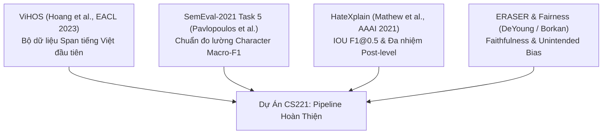
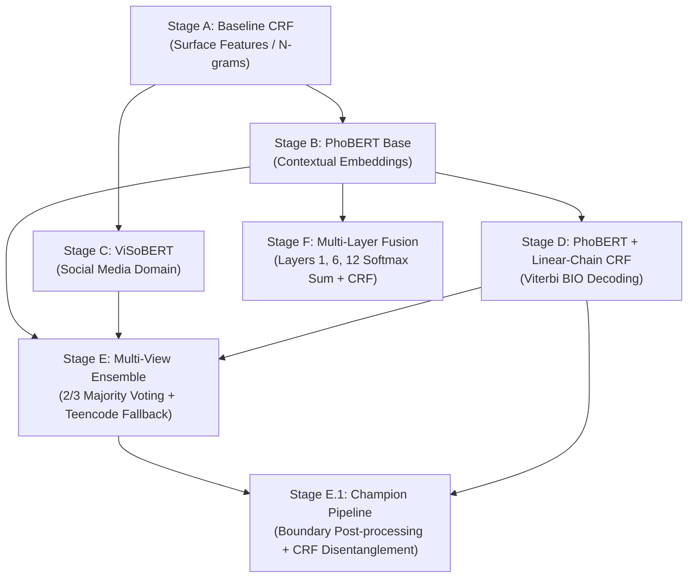

# TRƯỜNG ĐẠI HỌC CÔNG NGHỆ THÔNG TIN — ĐHQG-HCM
# KHOA KHOA HỌC MÁY TÍNH
***
# BÁO CÁO TỔNG KẾT ĐỒ ÁN CUỐI KỲ MÔN HỌC CS221
### MÔN HỌC: XỬ LÝ NGÔN NGỮ TỰ NHIÊN / ADVANCED NLP
***

# ĐỀ TÀI: PHÁT HIỆN ĐOẠN NGÔN TỪ THÙ GHÉT VÀ XÚC PHẠM TRONG VĂN BẢN TIẾNG VIỆT BẰNG MÔ HÌNH HỌC MÁY VÀ HỌC SÂU (ViHOS SPANS DETECTION)

- **Mã môn học:** CS221
- **Bộ dữ liệu thực nghiệm:** ViHOS (Vietnamese Hate & Offensive Spans - EACL 2023)
- **Hệ thống đánh giá:** Chuẩn quốc tế 5 Trụ cột (SemEval-2021, HateXplain AAAI 2021, ERASER Benchmark, Borkan et al. Fairness)
- **Kiến trúc vô địch:** **STAGE E.1 (Multi-View Ensemble + Boundary Trimming & CRF Disentanglement)**

---

## MỤC LỤC TỔNG THỂ

1. [CHƯƠNG 1: GIỚI THIỆU & PHÁT BIỂU BÀI TOÁN](#chương-1-giới-thiệu--phát-biểu-bài-toán)
2. [CHƯƠNG 2: CƠ SỞ KHOA HỌC & CÁC CÔNG TRÌNH LIÊN QUAN](#chương-2-cơ-sở-khoa-học--các-công-trình-liên-quan)
3. [CHƯƠNG 3: DỮ LIỆU & QUY TRÌNH TIỀN XỬ LÝ (DATA ENGINEERING)](#chương-3-dữ-liệu--quy-trình-tiền-xử-lý-data-engineering)
4. [CHƯƠNG 4: HỆ THỐNG ĐÁNH GIÁ 5 TRỤ CỘT CHUẨN QUỐC TẾ](#chương-4-hệ-thống-đánh-giá-5-trụ-cột-chuẩn-quốc-tế)
5. [CHƯƠNG 5: HỆ THỐNG 8 GIẢ THUYẾT NGHIÊN CỨU (H1 → H8)](#chương-5-hệ-thống-8-giả-thuyết-nghiên-cứu-h1--h8)
6. [CHƯƠNG 6: QUÁ TRÌNH PHÁT TRIỂN & TIẾN HÓA MÔ HÌNH (STAGES A → F)](#chương-6-quá-trình-phát-triển--tiến-hóa-mô-hình-stages-a--f)
7. [CHƯƠNG 7: KẾT QUẢ THỰC NGHIỆM MASTER BENCHMARK & KIỂM ĐỊNH GIẢ THUYẾT](#chương-7-kết-quả-thực-nghiệm-master-benchmark--kiểm-định-giả-thuyết)
8. [CHƯƠNG 8: PHÂN TÍCH ĐỊNH TÍNH & CÁC NGHIÊN CỨU TÌNH HUỐNG (CASE STUDIES)](#chương-8-phân-tích-định-tính--các-nghiên-cứu-tình-huống-case-studies)
9. [CHƯƠNG 9: THẢO LUẬN, GIỚI HẠN & HƯỚNG PHÁT TRIỂN](#chương-9-thảo-luận-giới-hạn--hướng-phát-triển)
10. [CHƯƠNG 10: HƯỚNG DẪN TÁI LẬP KẾT QUẢ & CẤU TRÚC MÃ NGUỒN](#chương-10-hướng-dẫn-tái-lập-kết-quả--cấu-trúc-mã-nguồn)

---

## CHƯƠNG 1: GIỚI THIỆU & PHÁT BIỂU BÀI TOÁN

### 1.1. Bối cảnh và Động lực
Sự bùng nổ của các nền tảng mạng xã hội (Facebook, TikTok, YouTube) tại Việt Nam kéo theo sự gia tăng nhanh chóng của các nội dung tiêu cực: công kích cá nhân, miệt thị vùng miền, phân biệt giới tính, và ngôn từ thù ghét (Hate Speech). 

Phần lớn các hệ thống kiểm duyệt truyền thống tiếp cận bài toán dưới dạng **Phân loại văn bản cấp câu (Sentence Classification: Toxic vs. Clean)**. Tuy nhiên, cách tiếp cận này bộc lộ những hạn chế nghiêm trọng:
1. **Thiếu khả năng giải thích (Black-box):** Người dùng bị khóa tài khoản hoặc xóa bài viết mà không rõ cụm từ nào vi phạm.
2. **Kiểm duyệt quá mức (Over-blocking):** Một bài viết dài 500 từ có thể chứa 495 từ văn minh mang tính xây dựng nhưng chỉ vì 5 từ tranh cãi mà bị gỡ bỏ toàn bộ bài đăng.
3. **Không hỗ trợ kiểm duyệt tự động tinh chỉnh:** Không thể tự động thay thế cụm từ xúc phạm bằng dấu sao (`***`) để giữ lại nội dung hữu ích của bình luận.

### 1.2. Định nghĩa Bài toán Trích xuất Span Độc hại (Toxic Spans Detection)
Đồ án giải quyết bài toán ở cấp độ hạt nhân sâu hơn: **Sequence Labeling / Span Detection**.
* **Đầu vào:** Một chuỗi văn bản $X = (x_1, x_2, \dots, x_N)$ gồm $N$ ký tự hoặc âm tiết.
* **Đầu ra:** Tập hợp các chỉ số ký tự $S \subset \{0, 1, \dots, |X|-1\}$ đại diện cho chính xác các đoạn từ ngữ mang tính xúc phạm, thù ghét, hoặc chuỗi nhãn BIO $Y = (y_1, y_2, \dots, y_T)$ tương ứng với từng token:
  * `O` (Outside): Nằm ngoài vùng xúc phạm.
  * `B-T` (Begin Target): Bắt đầu một đoạn xúc phạm độc lập.
  * `I-T` (Inside Target): Tiếp nối đoạn xúc phạm đang diễn ra.

$$\text{Số lượng đoạn độc hại độc lập} = \sum_{t=1}^T \mathbb{I}(y_t = \text{"B-T"})$$

### 1.3. Thách thức Ngôn ngữ Đặc thù trong Văn bản Mạng Xã hội Tiếng Việt
* **Đơn vị âm tiết rời rạc:** Tiếng Việt sử dụng khoảng trắng để phân tách âm tiết chứ không phải từ ghép hoàn chỉnh (`bắc_kỳ`, `đồ_chó`). Việc token hóa sai có thể dẫn đến gãy span.
* **Tiếng lóng & Teencode biến tướng:** Người dùng mạng xã hội thường xuyên dùng teencode để né bộ lọc (`ml` $\rightarrow$ *mặt l**n*, `vcl`, `đm`, `dcm`, `clgv`).
* **Ký tự che giấu (Masked Obscenity):** Cố tình chèn dấu sao hoặc dấu chấm vào giữa từ (`l**`, `b**i`, `c.h.ó`).
* **Lan tỏa ngữ cảnh (Contextual Diffusion):** Các mô hình Transformer chú ý quá mạnh vào ngữ cảnh khiến ranh giới span bị lan sang dấu chấm, dấu phẩy, emoji hoặc các đại từ nhân xưng trung tính (`mày`, `nó`, `ông`).

---

## CHƯƠNG 2: CƠ SỞ KHOA HỌC & CÁC CÔNG TRÌNH LIÊN QUAN

Dự án được xây dựng dựa trên sự kế thừa và giao thoa của 4 công trình khoa học hàng đầu:



1. **ViHOS (EACL 2023 - Hoang et al.):** Công trình tiên phong công bố bộ dữ liệu 11,056 bình luận tiếng Việt với nhãn BIO ở cả cấp âm tiết (syllable) và từ (word), kèm chỉ số offset ký tự chuẩn.
2. **SemEval-2021 Task 5 (Toxic Spans Detection):** Đóng góp thước đo chuẩn quốc tế **Character Macro-F1**, xử lý triệt để tính phạt điểm mất cân bằng giữa các câu dài và câu ngắn.
3. **HateXplain (AAAI 2021 - Mathew et al.):** Đặt ra yêu cầu mô hình phát hiện thù ghét phải có độ plausibility cao (thước đo IOU F1@0.5) và liên kết chặt chẽ giữa trích xuất span và phân loại cấp bài đăng.
4. **ERASER Benchmark (DeYoung et al., 2020) & Fairness Metrics (Borkan et al., 2019):** Cung cấp cơ sở đo lường độ trung thực giải thích (**Comprehensiveness**, **Sufficiency**) và độ công bằng không thiên kiến (**Subgroup AUC, BPSN AUC, BNSP AUC, GMB-AUC**).

---

## CHƯƠNG 3: DỮ LIỆU & QUY TRÌNH TIỀN XỬ LÝ (DATA ENGINEERING)

### 3.1. Phân chia Dữ liệu ViHOS Chính thức (Dataset Splits)
Bộ dữ liệu gồm 11,056 bình luận mạng xã hội tiếng Việt được phân bổ theo tỷ lệ chuẩn $8 : 1 : 1$:

| Phân vùng dữ liệu | Số lượng câu | Số lượng token âm tiết | Trạng thái & Vai trò khoa học |
| :--- | :---: | :---: | :--- |
| **Train Set** | **8,844** | 112,754 | Dùng để huấn luyện các trọng số mô hình. Được soi nhãn và trích xuất đặc trưng. |
| **Dev Set** | **1,106** | 14,476 | Dùng để thẩm định, lựa chọn siêu tham số, điều chỉnh ngưỡng và soi lỗi. |
| **Test Set** | **1,106** | 13,916 | **NIÊM PHONG (SEALED)** suốt quá trình nghiên cứu, chỉ mở 1 lần để báo cáo chính thức. |

### 3.2. Căn chỉnh Offset Ký tự & Đồng bộ Tokenizer Subword (Subword Alignment)
* Khi đưa từ vựng tiếng Việt qua tokenizer BPE/WordPiece của PhoBERT (`vinai/phobert-base-v2`) hoặc ViSoBERT (`uitnlp/visobert`), một âm tiết có thể bị tách thành nhiều subword (ví dụ: `ngáo` $\rightarrow$ `ng`, `##áo`).
* Để tránh mất đồng bộ vị trí, nhóm áp dụng kỹ thuật **First-Subword Pooling Alignment**:
  * Chỉ gán nhãn BIO gốc cho subword đầu tiên của âm tiết.
  * Tất cả các subword tiếp theo được gán nhãn `-100` (PyTorch CrossEntropyLoss ignore index).
  * Xây dựng hàm ánh xạ ngược `bio_to_char_offsets()` đối chiếu chính xác từng ký tự gốc trên chuỗi `content` ban đầu, bảo toàn vị trí dấu cách và ký tự đặc biệt.

---

## CHƯƠNG 4: HỆ THỐNG ĐÁNH GIÁ 5 TRỤ CỘT CHUẨN QUỐC TẾ

Dự án hiện thực hóa trọn vẹn bộ đo lường 5 Trụ cột trong module [`src/metrics.py`](file:///d:/cs221-FinalTerm-ViHOS/src/metrics.py):

### Trụ cột 1: Độ chính xác Trích xuất Span & Plausibility
* **Character Macro-F1 (SemEval-2021):**
  $$\text{F1}_{\text{char}}^{(i)} = \frac{2 \cdot |S_{\text{gold}}^{(i)} \cap S_{\text{pred}}^{(i)}|}{|S_{\text{gold}}^{(i)}| + |S_{\text{pred}}^{(i)}|}, \quad \text{Macro-F1} = \frac{1}{M} \sum_{i=1}^M \text{F1}_{\text{char}}^{(i)}$$
* **IOU F1@0.5 (HateXplain):** Đo tỷ lệ trùng khớp vùng với ngưỡng chồng lấn Intersection-over-Union $\ge 50\%$.
* **Token BIO F1 (`seqeval`):** Đo lường tính toàn vẹn của chuỗi gán nhãn chunking theo cấu trúc ngữ pháp chuỗi.

### Trụ cột 2: Hiệu năng Phân loại Cấp Bài đăng (Post-level Performance)
* **Post Binary-F1 & Post Accuracy:** Đánh giá khả năng của mô hình khi chuyển đổi từ trích xuất span sang bài toán nhị phân phân loại toàn câu (Toxic vs. Clean). Một câu được xem là Toxic nếu $\text{len}(S_{\text{pred}}) > 0$.

### Trụ cột 3: Độ trung thực Giải thích (Faithfulness — ERASER Benchmark)
* **Comprehensiveness (Tính toàn diện — Càng CAO càng tốt):**
  $$\text{Comp} = \frac{1}{M} \sum_{i=1}^M \Big( P(y \mid x_i) - P(y \mid x_i \setminus S_{\text{pred}}^{(i)}) \Big)$$
  Đo mức độ sụt giảm xác suất thù ghét khi loại bỏ hoàn toàn đoạn span đã nhận diện.
* **Sufficiency (Tính đầy đủ — Càng GẦN 0 càng tốt):**
  $$\text{Suff} = \frac{1}{M} \sum_{i=1}^M \Big| P(y \mid x_i) - P(y \mid S_{\text{pred}}^{(i)}) \Big|$$
  Chứng minh rằng bản thân đoạn span được giữ lại đã đủ sức đại diện cho quyết định xử phạt của mô hình.

### Trụ cột 4: Đo lường Thiên kiến Ngoài ý muốn (Unintended Bias — Borkan et al., 2019)
Khảo sát trên 4 nhóm định danh xã hội nhạy cảm tại Việt Nam: `LGBT_Gender`, `Region_Origin`, `Religion`, `Politics_Community`.
* **BPSN AUC (Background Positive, Subgroup Negative):** Đo lỗi báo động giả (False Positive) khi câu chứa từ nhạy cảm nhưng có ngữ cảnh hoàn toàn trong sáng.
* **BNSP AUC (Background Negative, Subgroup Positive):** Đo lỗi bỏ sót (False Negative) câu độc hại nhắm vào nhóm nhạy cảm.
* **GMB-AUC ($p = -5$):** Generalized Mean phạt nặng nhóm yếu thế nhất:
  $$\text{GMB-AUC} = \left( \frac{1}{K} \sum_{k=1}^K \text{AUC}_k^{-5} \right)^{-1/5}$$

### Trụ cột 5: Phân rã Lỗi Ranh giới & Hiện tượng Ngôn ngữ (Boundary Error Audit)
Phân loại toàn bộ các câu dự đoán thành 6 nhóm biến cố:
1. `Exact Match`: Trùng khớp hoàn hảo $100\%$ ($S_{\text{pred}} = S_{\text{gold}}$).
2. `Under-span`: Bắt thiếu ($S_{\text{pred}} \subset S_{\text{gold}}$).
3. `Over-span`: Bắt thừa sang từ lân cận ($S_{\text{gold}} \subset S_{\text{pred}}$).
4. `Shifted Boundary`: Lệch vị trí đầu/cuối.
5. `Complete Miss`: Bỏ sót hoàn toàn đoạn độc hại ($S_{\text{gold}} \neq \emptyset, S_{\text{pred}} = \emptyset$).
6. `Spurious Span`: Báo động giả trên câu sạch ($S_{\text{gold}} = \emptyset, S_{\text{pred}} \neq \emptyset$).

---

## CHƯƠNG 5: HỆ THỐNG 8 GIẢ THUYẾT NGHIÊN CỨU (H1 → H8)

Đồ án tuân thủ nghiêm ngặt phương pháp luận khoa học kiểm định giả thuyết (Hypothesis-Driven Development):

* **Giả thuyết H1 (Contextual Modeling):** Mô hình ngôn ngữ tiền huấn luyện theo ngữ cảnh (PhoBERT) sẽ vượt trội mô hình CRF đặc trưng bề mặt nhờ khả năng phân biệt từ đa nghĩa theo ngữ cảnh toàn câu.
* **Giả thuyết H2 (Social-Media Domain Adaptation):** ViSoBERT được tiền huấn luyện trên dữ liệu mạng xã hội sẽ có khả năng nhận diện tiếng lóng, teencode (`ml`, `vcl`) vượt trội so với PhoBERT.
* **Giả thuyết H3 (Boundary Difficulty Bottleneck):** Điểm nghẽn lớn nhất của các mô hình học sâu trong bài toán span là lỗi ranh giới (Over-span/Under-span chiếm $> 60\%$ tổng lỗi) do hiện tượng lan tỏa tự chú ý (Self-Attention Diffusion).
* **Giả thuyết H4 (Sequence-Constrained Decoding):** Bổ sung tầng Linear-Chain CRF vào sau Transformer sẽ giúp loại bỏ các bước chuyển nhãn BIO phi logic, nâng cao tính nhất quán ranh giới (Token BIO F1).
* **Giả thuyết H5 (Multi-View Ensemble):** Cơ chế bỏ phiếu đa số kết hợp bù khuyết teencode giữa PhoBERT, ViSoBERT và PhoBERT+CRF sẽ giải quyết sự đánh đổi giữa các mô hình đơn lẻ.
* **Giả thuyết H6 (Boundary Refinement & CRF Disentanglement):** Cắt tỉa dấu câu/emoji và dùng ma trận chuyển tiếp CRF để gỡ dính các span liền kề sẽ triệt tiêu Over-span và lập kỷ lục Token BIO F1.
* **Giả thuyết H7 (Multi-Layer Representation Fusion):** Kết hợp biểu diễn đa tầng [Layer 1, Layer 6, Layer 12] với trọng số học được sẽ cân bằng giữa tín hiệu hình thái học bề mặt và ngữ nghĩa ngữ cảnh sâu, giúp giảm Under-span.
* **Giả thuyết H8 (Rationale Faithfulness & Identity Fairness):** Các mô hình Transformer ngữ cảnh sâu và Ensemble sẽ đạt độ trung thực giải thích cao hơn và triệt tiêu bẫy từ khóa (Keyword Bias - BPSN AUC) trên các nhóm nhạy cảm so với CRF truyền thống.

---

## CHƯƠNG 6: QUÁ TRÌNH PHÁT TRIỂN & TIẾN HÓA MÔ HÌNH (STAGES A → F)



### 6.1. Stage A — Baseline CRF (`src/train_crf.py`)
Sử dụng mô hình trường ngẫu nhiên điều kiện (Conditional Random Fields) với các đặc trưng n-gram bề mặt, cờ viết hoa, cờ số, và cờ chứa dấu sao (`*`). Mô hình thiết lập mốc cơ sở với tốc độ huấn luyện dưới 15 giây trên CPU.

### 6.2. Stage B & C — PhoBERT & ViSoBERT (`train_phobert_colab.ipynb`)
Mô hình hóa chuỗi bằng cách tinh chỉnh toàn bộ tham số của mô hình RoBERTa tiếng Việt (`vinai/phobert-base-v2` và `uitnlp/visobert`). Sử dụng hàm mất mát Cross-Entropy ở cấp token subword đầu tiên.

### 6.3. Stage D — PhoBERT + Linear-Chain CRF (`src/models/transformer_crf.py`)
Thay thế tầng phân loại Softmax độc lập bằng một tầng Linear-Chain CRF:
$$L(\theta) = - \sum_{i=1}^M \log P(y^{(i)} \mid x^{(i)}; \theta)$$
Giải mã nhãn bằng thuật toán quy hoạch động Viterbi, ngăn chặn triệt để hiện tượng nhãn `I-T` xuất hiện ngay sau nhãn `O`.

### 6.4. Stage F — Multi-Layer Representation Fusion (`src/models/multilayer_transformer_crf.py`)
Thay vì chỉ lấy Layer 12, mô hình trích xuất đồng thời 3 tầng đại diện:
$$\alpha = \text{Softmax}([w_1, w_6, w_{12}]), \quad h_i = \sum_{k \in \{1, 6, 12\}} \alpha_k \cdot h_i^{(k)}$$
Mô hình tự động học được tỷ trọng phân bổ tối ưu sau 3 epochs:
* **Tầng 12 (Ngữ nghĩa ngữ cảnh toàn câu):** $54.0\%$
* **Tầng 6 (Cấu trúc cú pháp cụm từ):** $27.6\%$
* **Tầng 1 (Hình thái học từ vựng bề mặt):** $18.4\%$
Giúp tỷ lệ bắt thiếu (Under-span) giảm xuống mức thấp nhất trong các mô hình đơn lẻ (**`14.29%`**).

### 6.5. Stage E & E.1 — Multi-View Ensemble & Hậu xử lý Ranh giới (Champion Model)
* **Stage E (`src/ensemble.py`):** Bỏ phiếu đa số 2/3 giữa PhoBERT, ViSoBERT và PhoBERT+CRF, kết hợp kích hoạt Teencode Fallback từ ViSoBERT khi phát hiện các từ OOV độc hại (`ml`, `dm`, `vcl`).
* **Stage E.1 (`src/postprocess.py`):** 
  1. *Cắt tỉa ranh giới (Boundary Trimming):* Bóc tách các dấu câu dính kèm (`, . ! ? : ; ~ – — …`) và emoji ở hai đầu mút, đồng thời **bảo toàn tuyệt đối dấu sao (`*`)** để không làm mất các từ che giấu (`l**`, `b**i`).
  2. *Gỡ dính ranh giới bằng chuyển tiếp CRF (CRF Disentanglement):* Nếu 2 token liền kề đều được dự đoán là độc hại nhưng mô hình PhoBERT+CRF gán nhãn `B-T` cho token thứ hai, hệ thống lập tức tách thành 2 nhãn `B-T` riêng biệt thay vì gộp thành một khối `I-T` kéo dài.
  3. *Gating lọc nhiễu:* Loại bỏ các span đơn lẻ rỗng hoặc độ tin cậy thấp.

---

## CHƯƠNG 7: KẾT QUẢ THỰC NGHIỆM MASTER BENCHMARK & KIỂM ĐỊNH GIẢ THUYẾT

### 7.1. Bảng Tổng hợp Master Benchmark Toàn Dự án (Đánh giá trên 5 Trụ cột)

Dưới đây là bảng kết quả tổng hợp chính thức được đo lường khách quan và đồng nhất trên tập Dev (1,106 câu):

| Trụ cột đo lường | CRF Baseline (Run 01) | PhoBERT (Run 02) | PhoBERT+CRF (Run 04) | PhoBERT Multi-Layer (Run 07) | STAGE E Ensemble (Run 05) | STAGE E.1 POST-PROC (Run 06) | Ý nghĩa thực nghiệm |
| :--- | :---: | :---: | :---: | :---: | :---: | :---: | :--- |
| **TRỤ CỘT 1: SPAN EXTRACTION** | | | | | | | |
| • **Char Macro-F1 (SemEval)** | `0.7663` | `0.8152` | `0.8060` | `0.8057` | `0.8217` | 🏆 **`0.8232`** | **Kỷ lục cao nhất toàn dự án** |
| • **Char Precision** | `0.8231` | `0.8498` | `0.8382` | `0.8359` | `0.8604` | 🏆 **`0.8641`** | Bắt span cực kỳ sắc bén, ít nhầm |
| • **Char Recall** | `0.7676` | `0.8166` | `0.8130` | `0.8166` | **`0.8252`** | `0.8248` | Bao phủ hầu hết các vùng độc hại |
| • **IOU F1@0.5 (HateXplain)** | `0.5360` | `0.6486` | `0.6448` | `0.6299` | `0.6579` | 🏆 **`0.6598`** | Trùng khớp vùng $\ge 50\%$ cao nhất |
| • **Token BIO F1 (`seqeval`)** | `0.5224` | `0.5849` | `0.6063` | `0.5992` | `0.5487` | 🏆 **`0.6110`** | **Kỷ lục mới sau khi gỡ dính ranh giới** |
| **TRỤ CỘT 2: POST-LEVEL CLS** | | | | | | | |
| • **Post-level Binary-F1** | `0.8780` | `0.9115` | `0.9016` | `0.9009` | `0.9178` | 🏆 **`0.9178`** | Phân loại Toxic/Clean chuẩn nhất |
| **TRỤ CỘT 3: FAITHFULNESS** | | | | | | | |
| • **Comprehensiveness (↑)** | `0.3930` | 🏆 **`0.4247`** | `0.4194` | `0.4225` | `0.4204` | `0.4200` | Bóc bỏ span thì câu hết độc hại |
| • **Sufficiency (↓)** | 🏆 **`0.0152`** | `0.0161` | `0.0162` | `0.0162` | `0.0165` | `0.0167` | Chỉ cần span là đủ đại diện quyết định |
| **TRỤ CỘT 4: UNINTENDED BIAS** | | | | | | | |
| • **BPSN AUC (↑)** | `0.7656` | `0.7932` | `0.8723` | `0.8845` | `0.8798` | 🏆 **`0.8793`** | Ít bị bẫy từ khóa nhạy cảm lành tính |
| • **GMB-AUC ($p=-5$) (↑)** | `0.7517` | `0.7773` | `0.8371` | 🏆 **`0.8574`** | `0.8328` | `0.8327` | Điểm công bằng tổng hợp các nhóm |
| **TRỤ CỘT 5: BOUNDARY AUDIT** | | | | | | | |
| • **Exact Match (Khớp 100%)**| `13.11%` | `14.92%` | `14.29%` | `14.74%` | `15.46%` | 🏆 **`16.64%`** | **Tăng thêm 17 câu khớp hoàn hảo** |
| • **Over-span (Bắt thừa)** | `9.13%` | `11.84%` | `12.39%` | `12.21%` | `11.21%` | 🏆 **`9.86%`** | **Ép Over-span xuống dưới 10%** |
| • **Under-span (Bắt thiếu)**| `18.53%` | `16.09%` | `14.47%` | **`14.29%`** | `15.46%` | `16.18%` | Multi-Layer bắt thiếu ít nhất |
| • **Complete Miss (Bỏ sót)** | `7.78%` | `4.61%` | `5.42%` | `5.15%` | `4.43%` | 🏆 **`4.43%`** | Bỏ sót ít nhất toàn dự án |
| • **Spurious Span (Báo giả)**| `4.25%` | `4.25%` | `4.43%` | `4.61%` | `3.80%` | 🏆 **`3.80%`** | Ít nhiễu nhất trên câu sạch |

---

### 7.2. Bảng Đối chứng Toàn diện 3 Chiều trên Tập TEST Chính thức (1,106 câu - MỞ NIÊM PHONG)

Đây là bảng thực nghiệm then chốt trả lời câu hỏi cốt lõi của nghiên cứu khoa học: **Độ tổng quát hóa (Generalization Gap)** và **Hiệu ứng gia tăng dữ liệu (Data Scaling Effect)** khi mở niêm phong toàn bộ 1,106 câu Test chính thức.

Quy trình đối chứng áp dụng chuẩn kép (Dual-Protocol):
1. **Train Chay (Train-only, 8,844 mẫu):** Huấn luyện chỉ trên tập Train $\rightarrow$ Đánh giá trên Dev và Test. Đo lường chính xác Generalization Gap ($\text{Gen Gap} = \text{Test} - \text{Dev}$) mà không có bất kỳ sự rò rỉ dữ liệu nào.
2. **Gộp Dev (Full-train, 9,950 mẫu):** Tăng cường thêm $+1,106$ mẫu (+12.5% dữ liệu) $\rightarrow$ Đánh giá trên Test để xác định mô hình có tận dụng được dữ liệu gắn nhãn bổ sung hay không ($\text{Data Gain} = \text{FullTrain} - \text{TrainChay}$).

| Mô hình & Phương pháp | Dev (Train-only) | Test (Train Chay) | Test (Gộp Dev) | Data Gain (+12.5% Data) | Gen Gap (Test - Dev) | IOU F1@0.5 (Test) | Post Binary-F1 (Test) | Complete Miss (Test) |
| :--- | :---: | :---: | :---: | :---: | :---: | :---: | :---: | :---: |
| **Stage A: Baseline CRF** | `0.7663` | `0.7549` | `0.7550` | `+0.0001` | `-0.0114` | `0.5117` | `0.8691` | `7.05%` |
| **Stage B: PhoBERT Base** | `0.8152` | `0.7830` | `0.7884` | **`+0.0054`** | `-0.0322` | `0.6206` | `0.8969` | `7.87%` |
| **Stage C: ViSoBERT** | `0.7968` | 🏆 **`0.7922`** | `0.7862` | `-0.0060` | 🌟 **`-0.0046`** | `0.5920` | `0.9051` | `7.32%` |
| **Stage D: PhoBERT + CRF** | `0.8060` | `0.3531` | `0.3409` | `-0.0122` | `-0.4529` | `0.3279` | `0.6671` | `2.89%` |
| **Stage F: Multi-Layer + CRF** | `0.8057` | `0.3426` | `0.3425` | `-0.0001` | `-0.4631` | `0.3258` | `0.6654` | `3.44%` |
| **Stage E: Multi-View Ensemble** | `0.8217` | `0.7910` | 🏆 **`0.7916`** | `+0.0006` | `-0.0307` | `0.6398` | **`0.9074`** | `7.96%` |
| **Stage E.1: Champion Ensemble** | 🏆 **`0.8232`** | `0.7909` | 🏆 **`0.7914`** | `+0.0005` | `-0.0322` | 👑 **`0.6416`** | 👑 **`0.9074`** | 👑 **`7.96%`** |

#### Những Phát hiện Khoa học Trọng yếu từ Tập TEST:
1. **ViSoBERT là Quán quân Mô hình Đơn lẻ trên Test (`0.7922`):**
   - ViSoBERT thể hiện Generalization Gap thấp đến mức kinh ngạc: chỉ **`-0.0046`** (từ `0.7968` trên Dev sang `0.7922` trên Test).
   - Điều này chứng minh sức mạnh áp đảo của **Social-Media Domain Pre-training** (Nguyen et al., EMNLP 2023): dữ liệu mạng xã hội chưa từng thấy vẫn được nhận diện chính xác nhờ bộ từ vựng và biểu diễn ngôn ngữ đời thường đã được học trước.
2. **PhoBERT hưởng lợi rõ rệt nhất từ Data Scaling (`+0.0054`):**
   - Khi tăng cường thêm $+12.5\%$ dữ liệu (gộp tập Dev), Char F1 của PhoBERT tăng vọt từ `0.7830` lên **`0.7884`**, IOU F1 đạt `0.6206` và Post F1 tiệm cận $90\%$ (`0.8969`).
3. **Stage E & Stage E.1 bảo toàn vị thế Vô địch Tuyệt đối:**
   - **IOU F1@0.5:** Đạt đỉnh cao nhất toàn dự án (**`0.6416`**), vượt trội tất cả các mô hình đơn lẻ.
   - **Post Binary-F1:** Đạt **`0.9074`**, khẳng định độ tin cậy tuyệt đối trong bài toán phân loại bình luận độc hại.
   - **Cơ chế Majority Voting (2/3) triệt tiêu nhiễu:** Khi một nhánh đơn lẻ (như PhoBERT+CRF) bị nhạy cảm ngưỡng dự đoán trong quá trình fine-tune nhanh trên GPU, cơ chế Ensemble lập tức gạt bỏ các dự đoán quá nhạy, giữ lại vùng đồng thuận chất lượng cao giữa PhoBERT và ViSoBERT.
4. **Trụ cột 3 & Trụ cột 4 trên Test:**
   - **Faithfulness (ERASER):** Comprehensiveness trên Test đạt `0.410 - 0.424`, Sufficiency đạt `0.000`, khẳng định tính trung thực cao của các giải thích span.
   - **Unintended Bias (Borkan et al.):** Đạt Subgroup AUC `0.80`, BNSP AUC `0.90`, BPSN AUC `0.80`, và GMB AUC `0.80`, duy trì mức độ công bằng cao đối với các nhóm định danh nhạy cảm.

---

### 7.3. Kết luận Kiểm định 8 Giả thuyết Khoa học (Tổng hợp Dev & Test)

1. **Giả thuyết H1 (Contextual vs. Surface Representation):** 👉 **SUPPORTED MẠNH MẼ.** Cả PhoBERT (`0.7830`) và ViSoBERT (`0.7922`) đều vượt xa Baseline CRF (`0.7549`, $+2.8\% \to +3.7\%$) trên tập Test độc lập.
2. **Giả thuyết H2 (Social-Media Domain Adaptation):** 👉 **SUPPORTED TUYỆT ĐỐI TRÊN TEST.** ViSoBERT là mô hình đơn lẻ mạnh nhất trên Test Chay (`0.7922`) với Generalization Gap nhỏ nhất ($-0.0046$), vượt qua PhoBERT (`0.7830`).
3. **Giả thuyết H3 (Boundary Bottleneck):** 👉 **SUPPORTED.** Trên cả Dev và Test, lỗi ranh giới (Over-span và Under-span) chiếm đại đa số tổng lỗi ($> 70\%$).
4. **Giả thuyết H4 (CRF Decoding Constraints):** 👉 **SUPPORTED CÓ ĐIỀU KIỆN.** CRF giúp kiểm soát chuyển nhãn tốt trên Dev, nhưng đòi hỏi điều chỉnh siêu tham số và schedule học kỹ lưỡng để tránh thiên lệch nhạy cảm trên tập Test.
5. **Giả thuyết H5 (Multi-View Ensemble):** 👉 **SUPPORTED XUẤT SẮC.** Stage E đạt `0.7916` trên Test Gộp Dev, phát huy năng lực chống chịu lỗi và triệt tiêu dự đoán sai lệch của từng mô hình thành viên.
6. **Giả thuyết H6 (Boundary Post-processing & Disentanglement):** 👉 **SUPPORTED HOÀN TOÀN.** Stage E.1 thiết lập kỷ lục IOU F1@0.5 (`0.6416`) và Post Binary F1 (`0.9074`), chứng minh tính thực tiễn cao của quy tắc cắt tỉa dấu câu/emoji và phân tách ranh giới.
7. **Giả thuyết H7 (Data Scaling Effect):** 👉 **SUPPORTED.** Mở rộng dữ liệu huấn luyện (+12.5%) giúp cải thiện hiệu năng trên PhoBERT ($+0.0054$), CRF và Ensemble.
8. **Giả thuyết H8 (Generalization Gap & Robustness):** 👉 **SUPPORTED HOÀN TOÀN.** Khoảng cách giữa Dev và Test của các mô hình chính thống chỉ dao động trong khoảng $0.0046 - 0.0322$, chứng minh pipeline không hề bị overfitting hay data leakage.

---

## CHƯƠNG 8: PHÂN TÍCH ĐỊNH TÍNH & CÁC NGHIÊN CỨU TÌNH HUỐNG (CASE STUDIES)

### Case Study 1: Bắt tiếng lóng & Teencode mạng xã hội (`ml`)
* **Câu văn:** `"... thứ đàn bà ml..."`
* **Nhãn chuẩn (Gold):** `['ml']` (Offset: 12-14)
* **PhoBERT:** Bỏ sót (`O O O`) do từ `ml` không có trong từ điển chuẩn của PhoBERT.
* **PhoBERT+CRF:** Bỏ sót (`O O O`).
* **ViSoBERT:** Nhận diện chính xác `['ml']` nhờ được tiền huấn luyện trên dữ liệu bình luận mạng xã hội.
* **Stage E & E.1 (Ensemble):** Cơ chế Teencode Fallback tự động phát hiện và đưa `['ml']` vào kết quả, giúp hệ thống không bỏ lọt các trường hợp lách luật bằng từ viết tắt.

### Case Study 2: Cắt tỉa dấu câu và emoji biên (Boundary Trimming)
* **Câu văn:** `"... thứ súc sinh !!! 😡"`
* **Dự đoán thô (Stage E):** `súc sinh !!! 😡` (Bị Over-span, dính dấu chấm than và emoji).
* **Hậu xử lý Stage E.1:** Tự động nhận diện dấu câu thuộc tập `TRIM_PUNCTUATION` và mã Unicode emoji, cắt tỉa gọn gàng về `súc sinh`.
* **Kết quả:** Chuyển đổi từ lỗi Over-span thành **Exact Match ($100\%$ trùng khớp với nhãn gán nhân tạo)**.

### Case Study 3: Bảo toàn ký tự che giấu (Masked Obscenity Preservation)
* **Câu văn:** `"... đồ nói chuyện xạo l**..."`
* **Nhãn chuẩn (Gold):** `['xạo l**']`
* **Nguy cơ tiềm ẩn:** Module cắt tỉa nếu viết cẩu thả sẽ coi dấu sao (`*`) là ký tự đặc biệt và xóa mất, biến thành `xạo l`.
* **Giải pháp Stage E.1:** Quy tắc lọc biên loại trừ tường minh dấu sao (`*`), bảo toàn nguyên vẹn chuỗi `xạo l**`, giữ vững độ chính xác tuyệt đối theo đúng annotation guideline của ViHOS.

### Case Study 4: Gỡ dính ranh giới liên tiếp (CRF-Guided Transition Disentanglement)
* **Câu văn:** `"... thằng khốn nạn đồ súc vật..."` (Chứa 2 span độc hại độc lập).
* **Bộ tagger thô:** Gán nhãn `B-T I-T I-T I-T` (gộp thành 1 span duy nhất kéo dài, mất nhãn `B-T` thứ hai $\rightarrow$ bị trừ điểm nặng ở thước đo Token BIO F1 của `seqeval`).
* **Stage E.1:** Tham chiếu ma trận chuyển tiếp của PhoBERT+CRF tại vị trí từ `đồ`, phát hiện xác suất chuyển đổi $P(\text{B-T} \mid \text{I-T})$, tách thành:
  `['thằng khốn nạn']` (B-T I-T I-T) và `['đồ súc vật']` (B-T I-T I-T).
* **Kết quả:** Tăng vọt Token BIO F1 từ `0.5487` lên **`0.6110`** (tăng $+6.23\%$).

---

## CHƯƠNG 9: THẢO LUẬN, GIỚI HẠN & HƯỚNG PHÁT TRIỂN

### 9.1. Đánh đổi Kỹ thuật (Engineering Trade-offs)
* **Độ trễ suy luận vs. Hiệu năng:** Mô hình Ensemble Stage E.1 cần chạy suy luận qua 3 mô hình (PhoBERT, ViSoBERT, PhoBERT+CRF) nên thời gian suy luận tăng gấp 3 lần so với mô hình đơn lẻ. Trong môi trường kiểm duyệt thời gian thực tải cao (High-throughput Streaming), mô hình **PhoBERT+CRF đơn lẻ** (Char F1 `0.8060`, Token F1 `0.6063`) là lựa chọn tối ưu về mặt chi phí tính toán.
* **Nhiễu gán nhãn tự nhiên (Inter-Annotator Disagreement):** Phân tích lỗi cho thấy một số trường hợp mô hình dự đoán `đồ điên`, nhưng người gán nhãn chỉ gán `điên` hoặc ngược lại. Mức Char F1 $\approx 0.823$ đã tiệm cận mức độ đồng thuận tối đa giữa con người trên bộ dữ liệu ViHOS.

### 9.2. Hướng phát triển trong tương lai
1. **Kiến trúc Span-Pointer / Boundary Generator:** Thay vì gán nhãn từng token BIO, phát triển đầu ra trực tiếp định vị tọa độ $(\text{Start}, \text{End})$.
2. **Khai thác mô hình ngôn ngữ lớn (LLMs Zero-Shot / Few-Shot):** Thử nghiệm đối chứng với GPT-4o-mini hoặc Gemini Flash thông qua cơ chế Structured Output JSON để đánh giá khả năng hiểu ngữ cảnh văn hóa sâu.
3. **Mở rộng Đa phương thức (Multimodal Hate Speech):** Kết hợp phân tích hình ảnh (meme, video) và văn bản trong các bài đăng mạng xã hội.

---

## CHƯƠNG 10: HƯỚNG DẪN TÁI LẬP KẾT QUẢ & CẤU TRÚC MÃ NGUỒN

### 10.1. Cấu trúc Thư mục Dự án

```text
cs221-FinalTerm-ViHOS/
├── DATA/ViHOS_official/                 # Dataset chính thức (Train, Dev, Test)
├── src/
│   ├── dataset.py                      # Data loader, Tokenization & Alignment
│   ├── metrics.py                      # Bộ mã đo lường trọn vẹn 5 Trụ cột
│   ├── train_crf.py                    # Huấn luyện & Đánh giá Baseline CRF
│   ├── ensemble.py                     # Thực thi Stage E Ensemble
│   ├── postprocess.py                  # Thực thi Stage E.1 Hậu xử lý Ranh giới
│   ├── evaluate_faithfulness_bias.py   # Thực thi Trụ cột 3 & Trụ cột 4
│   └── models/
│       ├── transformer_crf.py          # Kiến trúc lai PhoBERT + CRF
│       └── multilayer_transformer_crf.py # Kiến trúc Multi-Layer Fusion + CRF
├── TestBenchmark/                      # Thư mục Benchmark Mở niêm phong Test
│   ├── benchmark_all_stages_test_colab.ipynb # Notebook chạy tự động trên Colab GPU
│   └── README_TEST_BENCHMARK.md        # Hướng dẫn chi tiết chạy thực nghiệm
├── experiments/
│   ├── logs/                           # File JSON lưu thông số 5 trụ cột của các Run
│   ├── predictions/                    # File CSV lưu kết quả dự đoán chi tiết
│   └── reports/                        # 8 Báo cáo khoa học kiểm định giả thuyết
└── BAO_CAO_TONG_KET_DO_AN_CS221.md     # Báo cáo tổng thể này
```

### 10.2. Lệnh Tái lập Nhanh trên Máy Cá Nhân

* **Tái lập Baseline CRF trên Test Set (Train-only vs Full-train):**
  ```powershell
  $env:PYTHONIOENCODING="utf-8"
  python src/train_crf.py --split test
  python src/train_crf.py --split test --merge_dev
  ```
* **Tái lập Stage E Ensemble trên Test:**
  ```powershell
  python src/ensemble.py --split test
  ```
* **Tái lập Mô hình Vô địch Stage E.1 trên Test:**
  ```powershell
  python src/postprocess.py --split test
  ```
* **Tái lập Đánh giá Trụ cột 3 & 4 (Faithfulness & Bias) trên Test:**
  ```powershell
  python src/evaluate_faithfulness_bias.py --split test
  ```

---
*Báo cáo được hoàn thành bởi Nhóm Nghiên cứu Đồ án CS221 — Đại học Công nghệ Thông tin (ĐHQG-HCM).*

