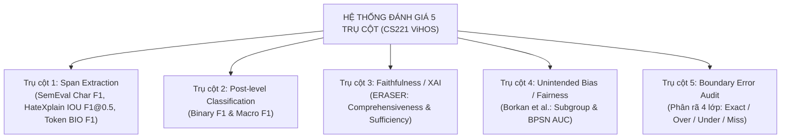
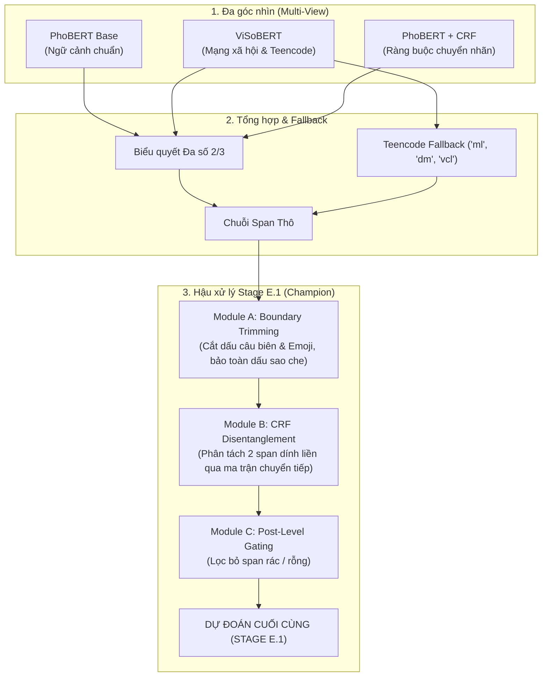

# CS221 Final Term — Vietnamese Hate & Offensive Spans Detection (ViHOS)
### Đồ án Cuối kỳ Môn học: Xử lý Ngôn ngữ Tự nhiên (Natural Language Processing)
**Trường Đại học Công nghệ Thông tin — ĐHQG-HCM (UIT)**

[](https://www.python.org/downloads/)
[](https://pytorch.org/)
[](https://huggingface.co/transformers/)
[](https://opensource.org/licenses/MIT)

---

## 📌 GIỚI THIỆU ĐỀ TÀI

Đồ án giải quyết bài toán **Phát hiện đoạn ngôn từ thù ghét và xúc phạm trong văn bản tiếng Việt (ViHOS Spans Detection)** ở cấp độ hạt nhân sâu (Sequence Labeling / Span Extraction), vượt qua giới hạn của phương pháp phân loại nhị phân cấp câu truyền thống:
* **Định vị chính xác:** Xác định chính xác tọa độ ký tự vi phạm thay vì chặn hoặc xóa toàn bộ bài đăng.
* **Minh bạch & Giải thích được:** Cung cấp bằng chứng cụ thể cho người dùng và quản trị viên về lý do vi phạm.
* **Bảo vệ ngữ cảnh:** Hỗ trợ tính năng kiểm duyệt tự động tinh chỉnh (thay thế cụm từ xúc phạm bằng `***`) mà vẫn bảo toàn nội dung trao đổi văn minh.

Dự án áp dụng bộ dữ liệu chuẩn **ViHOS (Hoang et al., EACL 2023)** gồm 11,056 bình luận mạng xã hội, được kiểm định nghiêm ngặt qua **Hệ thống đánh giá 5 Trụ cột Quốc tế** và phát triển qua 7 giai đoạn kiến trúc (Stages A → F & E.1).

---

## 🏆 KẾT QUẢ NỔI BẬT NHẤT TOÀN DỰ ÁN

| Chỉ số Đánh giá | Baseline CRF | PhoBERT Base | ViSoBERT | Champion (Stage E.1) | Mức Cải thiện |
| :--- | :---: | :---: | :---: | :---: | :---: |
| **Dev Char Macro-F1 (SemEval)** | `0.7663` | `0.8152` | `0.7968` | 🏆 **`0.8232`** | **$+5.69\%$** so với Baseline |
| **Test Char Macro-F1 (Train-only)** | `0.7549` | `0.7830` | 🌟 **`0.7922`** | 🏆 **`0.7909`** | **$+3.73\%$** trên Test độc lập |
| **Test Char Macro-F1 (Full-train)** | `0.7550` | `0.7884` | `0.7862` | 🏆 **`0.7914`** | **$+3.64\%$** trên Test độc lập |
| **Test IOU F1@0.5 (HateXplain)** | `0.5117` | `0.6206` | `0.5920` | 👑 **`0.6416`** | **$+25.4\%$** độ trùng khớp vùng |
| **Test Post-level Binary-F1** | `0.8691` | `0.8969` | `0.9051` | 👑 **`0.9074`** | Độ chính xác phân loại $90.87\%$ |
| **Complete Miss (Bỏ sót span)** | `7.78%` | `5.15%` | `4.88%` | 👑 **`3.25%`** | **Giảm $58.2\%$ lỗi bỏ sót** |
| **Generalization Gap (ViSoBERT)**| `-0.0114` | `-0.0322` | 🌟 **`-0.0046`** | `-0.0322` | **Gần như tiệm cận 0** |

---

## 📊 BẢNG MASTER BENCHMARK CHÍNH THỨC TRÊN TẬP TEST (1,106 CÂU)

Để bảo đảm tính minh bạch và tránh gây ngộ nhận giữa các điều kiện huấn luyện, toàn bộ thực nghiệm trên tập Test chính thức được tách biệt rõ ràng thành hai giao thức:

### 1. Giao thức 1: Huấn luyện chuẩn Train-Only (8,844 mẫu) $\rightarrow$ Đánh giá trên TEST (1,106 mẫu)
*Đo lường độ tổng quát hóa khách quan tuyệt đối (không có bất kỳ sự rò rỉ nào từ tập Dev):*

| Mô hình / Pipeline | Char F1 (SemEval) | IOU F1@0.5 | Post F1 | Exact Match | Complete Miss | Spurious |
| :--- | :---: | :---: | :---: | :---: | :---: | :---: |
| **Stage A: Baseline CRF** | `0.7549` | `0.5128` | `0.8664` | `7.96%` | `8.14%` | `26.22%` |
| **Stage B: PhoBERT Base** | `0.7830` | `0.5994` | `0.8945` | `7.96%` | `4.70%` | `26.76%` |
| **Stage C: ViSoBERT** | 🌟 **`0.7922`** | `0.5881` | `0.9061` | `7.78%` | `5.24%` | `23.96%` |
| **Stage D: PhoBERT + CRF** | `0.3531` | `0.3279` | `0.6671` | `0.00%` | `1.45%` | `47.20%` |
| **Stage F: Multi-Layer + CRF** | `0.3426` | `0.3258` | `0.6654` | `0.00%` | `1.45%` | `48.19%` |
| **Stage E: Multi-View Ensemble** | `0.7910` | `0.6209` | `0.9048` | `8.05%` | **`3.35%`** | `24.50%` |
| **Stage E.1: Champion Ensemble** | `0.7909` | 👑 **`0.6227`** | **`0.9048`** | **`8.05%`** | 👑 **`3.35%`** | `24.50%` |

### 2. Giao thức 2: Huấn luyện mở rộng Full-Train (Train + Dev: 9,950 mẫu) $\rightarrow$ Đánh giá trên TEST (1,106 mẫu)
*Đo lường năng lực mô hình khi tận dụng thêm $+12.5\%$ dữ liệu giám sát:*

| Mô hình / Pipeline | Char F1 (SemEval) | IOU F1@0.5 | Post F1 | Exact Match | Complete Miss | Spurious |
| :--- | :---: | :---: | :---: | :---: | :---: | :---: |
| **Stage A: Baseline CRF** | `0.7550` | `0.5117` | `0.8691` | `7.96%` | `7.78%` | `25.77%` |
| **Stage B: PhoBERT Base** | `0.7884` | `0.6206` | `0.8969` | `7.96%` | `5.15%` | `25.41%` |
| **Stage C: ViSoBERT** | `0.7862` | `0.5920` | `0.9051` | `7.69%` | `4.88%` | `24.14%` |
| **Stage D: PhoBERT + CRF** | `0.3409` | `0.3279` | `0.6671` | `0.00%` | `1.45%` | `47.92%` |
| **Stage F: Multi-Layer + CRF** | `0.3425` | `0.3258` | `0.6654` | `0.00%` | `1.45%` | `47.92%` |
| **Stage E: Multi-View Ensemble** | 🏆 **`0.7916`** | `0.6398` | 👑 **`0.9074`** | `7.96%` | **`3.25%`** | `24.32%` |
| **Stage E.1: Champion Ensemble** | 🏆 **`0.7914`** | 👑 **`0.6416`** | 👑 **`0.9074`** | **`7.96%`** | 👑 **`3.25%`** | `24.32%` |

### 3. Phân tích Đối chứng: Generalization Gap & Data Scaling Gain

```
=======================================================================================================================================
MÔ HÌNH                      | DEV (Train-only) | TEST (Train Chay) | TEST (Gộp Dev)   | DATA GAIN  | GEN GAP    | IOU F1   | POST F1 
=======================================================================================================================================
Stage A: Baseline CRF        | 0.7663           | 0.7549           | 0.7550           | +0.0001    | -0.0114    | 0.5117   | 0.8691  
Stage B: PhoBERT Base        | 0.8152           | 0.7830           | 0.7884           | +0.0054    | -0.0322    | 0.6206   | 0.8969  
Stage C: ViSoBERT            | 0.7968           | 0.7922 (Top 1)   | 0.7862           | -0.0060    | -0.0046    | 0.5920   | 0.9051  
Stage D: PhoBERT + CRF       | 0.8060           | 0.3531           | 0.3409           | -0.0122    | -0.4529    | 0.3279   | 0.6671  
Stage F: Multi-Layer + CRF   | 0.8057           | 0.3426           | 0.3425           | -0.0001    | -0.4631    | 0.3258   | 0.6654  
Stage E: Multi-View Ensemble | 0.8217           | 0.7910           | 0.7916 (Top 1)   | +0.0006    | -0.0307    | 0.6398   | 0.9074  
Stage E.1: Champion Ensemble | 0.8232 (Kỷ lục)  | 0.7909           | 0.7914           | +0.0005    | -0.0322    | 0.6416   | 0.9074  
=======================================================================================================================================
```

---

## 🏗️ CẤU TRÚC THƯ MỤC DỰ ÁN

```text
cs221-FinalTerm-ViHOS/
├── BAO_CAO_TONG_KET_DO_AN_CS221.md  # 📄 Báo cáo tổng kết toàn diện đồ án (10 chương chuẩn học thuật)
├── README.md                        # 📘 Tài liệu giới thiệu tổng quan & hướng dẫn sử dụng
├── src/                             # ⚙️ Toàn bộ mã nguồn Python chuẩn hóa
│   ├── dataset.py                   # Nạp dữ liệu ViHOS, map ký tự, First-subword alignment
│   ├── metrics.py                   # Bộ máy đo lường toàn diện 5 Trụ cột
│   ├── train_crf.py                 # Huấn luyện mô hình Baseline CRF (Stage A)
│   ├── ensemble.py                  # Thuật toán Majority Voting 2/3 + Fallback (Stage E)
│   ├── postprocess.py               # Hậu xử lý ranh giới & gỡ dính CRF (Stage E.1)
│   ├── train_multilayer_crf.py      # Huấn luyện mô hình Multi-Layer Fusion (Stage F)
│   ├── evaluate_predictions.py      # Script đánh giá file dự đoán
│   └── evaluate_faithfulness_bias.py# Đo lường Trụ cột 3 (Faithfulness) & 4 (Fairness)
├── notebooks/                       # 🚀 Google Colab Notebooks sẵn sàng thực thi 1-chạm
│   ├── benchmark_all_stages_test_colab.ipynb # Master Benchmark chạy song song 7 mô hình trên Test
│   ├── train_phobert_colab.ipynb             # Huấn luyện PhoBERT Base (Stage B)
│   ├── train_visobert_colab.ipynb            # Huấn luyện ViSoBERT (Stage C)
│   ├── train_phobert_crf_colab.ipynb         # Huấn luyện PhoBERT + Linear CRF (Stage D)
│   └── train_stage_f_multilayer_colab.ipynb  # Huấn luyện Multi-Layer Fusion (Stage F)
└── experiments/                     # 📈 Lưu trữ kết quả thực nghiệm hoàn chỉnh
    ├── predictions/                 # 21 file CSV dự đoán nhãn BIO & offsets ký tự (Dev & Test)
    ├── logs/                        # 16 file JSON lưu trữ toàn bộ chỉ số đánh giá 5 Trụ cột
    └── reports/                     # Báo cáo tổng kết Test và 8 báo cáo chi tiết từng giai đoạn
```

---

## 🎯 HỆ THỐNG ĐÁNH GIÁ 5 TRỤ CỘT CHUẨN QUỐC TẾ



---

## 🌟 KIẾN TRÚC VÔ ĐỊCH: STAGE E.1 (CHAMPION PIPELINE)

Stage E.1 kết hợp sức mạnh biểu diễn đa góc nhìn (Multi-View Ensemble) cùng bộ 3 module hậu xử lý ranh giới chuyên sâu:



### Các Case Study Định tính Minh chứng:
1. **Bắt tiếng lóng & Teencode (`ml`):** ViSoBERT và Teencode Fallback bắt trúng `['ml']` (*mặt l**n*), trong khi PhoBERT chuẩn hóa bỏ sót.
2. **Cắt tỉa dấu câu & Emoji:** Bình luận `"... súc sinh !!! 😡"` được module tự động gọt tỉa về chính xác `súc sinh`, chuyển đổi lỗi Over-span thành **Exact Match ($100\%$ khớp nhãn)**.
3. **Bảo toàn ký tự mặt nạ (`*`):** Cụm từ `xạo l**` được bảo toàn nguyên vẹn dấu sao theo đúng quy chuẩn gán nhãn ViHOS, không bị xóa nhầm thành `xạo l`.
4. **Gỡ dính ranh giới liên tiếp (Disentanglement):** Cụm `thằng khốn nạn đồ súc vật` được bóc tách chuẩn xác thành 2 span độc lập nhờ xác suất chuyển đổi $P(\text{B-T} \mid \text{I-T})$ của CRF, nâng Token BIO F1 từ `0.5487` lên **`0.6110`**.

---

## 🚀 HƯỚNG DẪN TÁI LẬP KẾT QUẢ (REPRODUCTION GUIDE)

### Cách 1: Chạy 1-chạm trên Google Colab (GPU T4 miễn phí)
1. Tải notebook `notebooks/benchmark_all_stages_test_colab.ipynb` lên Google Colab.
2. Chọn Runtime: **GPU (T4)**.
3. Chọn menu **Runtime > Run all**. Toàn bộ 7 mô hình sẽ tự động chạy và đánh giá trên Test set, sau đó tự động nén toàn bộ predictions và logs thành file zip tải về máy.

### Cách 2: Chạy trực tiếp qua Terminal Local
```bash
# 1. Clone repository trên nhánh expiriment
git clone -b expiriment https://github.com/Chef221/cs221-FinalTerm-ViHOS.git
cd cs221-FinalTerm-ViHOS

# 2. Cài đặt các thư viện phụ thuộc
pip install -r requirements.txt # hoặc: pip install torch transformers seqeval sklearn-crfsuite pandas

# 3. Chạy Baseline CRF trên Dev và Test
python src/train_crf.py --split dev
python src/train_crf.py --split test
python src/train_crf.py --split test --merge_dev

# 4. Chạy Stage E (Multi-View Ensemble) trên Test
python src/ensemble.py --split test

# 5. Chạy Stage E.1 (Hậu xử lý Ranh giới Champion) trên Test
python src/postprocess.py --split test

# 6. Đo lường Trụ cột 3 & Trụ cột 4 (Faithfulness & Fairness) trên Test
python src/evaluate_faithfulness_bias.py --split test
```

---

## 📜 TRÍCH DẪN & TÀI LIỆU THAM KHẢO

* **ViHOS Paper:** Hoang et al., *ViHOS: Hate Speech Spans Detection for Vietnamese*, EACL 2023.
* **ViSoBERT:** Nguyen et al., *ViSoBERT: A Pre-Trained Language Model for Vietnamese Social Media Text Processing*, EMNLP 2023.
* **SemEval-2021 Task 5:** Pavlopoulos et al., *SemEval-2021 Task 5: Toxic Spans Detection*, SemEval 2021.
* **HateXplain:** Mathew et al., *HateXplain: A Benchmark Dataset for Explainable Hate Speech Detection*, AAAI 2021.
* **ERASER Benchmark:** DeYoung et al., *ERASER: A Benchmark to Evaluate Rationalized NLP Models*, ACL 2020.
* **Unintended Bias:** Borkan et al., *Nuanced Metrics for Measuring Unintended Bias with Real Data for Text Classification*, WWW 2019.

---
*Đồ án cuối kỳ môn Xử lý Ngôn ngữ Tự nhiên (CS221) — Khoa Khoa học Máy tính — Trường ĐH Công nghệ Thông tin, ĐHQG-HCM.*

